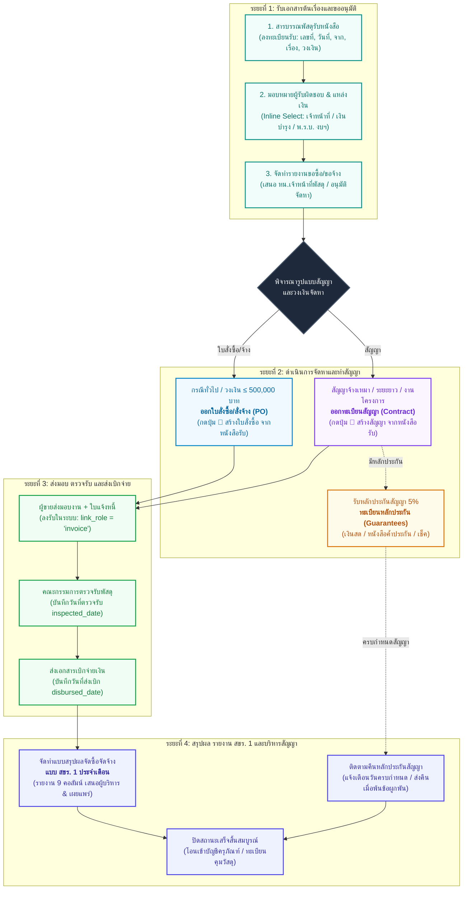
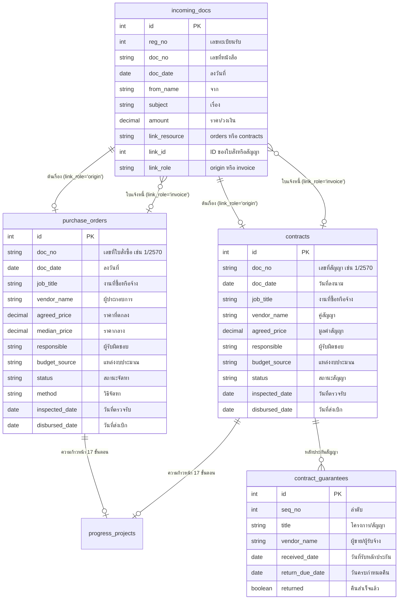

# คู่มือระบบและผังกระบวนการทำงานพัสดุและสัญญาภาครัฐ (Procurement Workflow Manual)
**กองโรคติดต่อทั่วไป กรมควบคุมโรค กระทรวงสาธารณสุข**  
*อ้างอิง: พ.ร.บ. การจัดซื้อจัดจ้างและการบริหารพัสดุภาครัฐ พ.ศ. 2560 และ พ.ร.บ. ข้อมูลข่าวสารของราชการ พ.ศ. 2540 (แบบ สขร. 1)*

---

## 📌 สารบัญ
1. [ภาพรวมและสถาปัตยกรรมระบบ (System Overview)](#1-ภาพรวมและสถาปัตยกรรมระบบ)
2. [ผังวงจรชีวิตงานพัสดุ (Procurement Lifecycle Flowchart)](#2-ผังวงจรชีวิตงานพัสดุ-flowchart)
3. [รายละเอียด 4 ระยะของกระบวนการจัดหา (4-Phase Lifecycle Details)](#3-รายละเอียด-4-ระยะของกระบวนการจัดหา)
   - [ระยะที่ 1: รับเรื่องและขออนุมัติ (Origin & Requisition)](#ระยะที่-1-รับเรื่องและขออนุมัติ)
   - [ระยะที่ 2: ดำเนินการจัดหาและทำสัญญา (Procurement & Contract)](#ระยะที่-2-ดำเนินการจัดหาและทำสัญญา)
   - [ระยะที่ 3: ตรวจรับพัสดุและส่งเบิกจ่าย (Inspection & Disbursement)](#ระยะที่-3-ตรวจรับพัสดุและส่งเบิกจ่าย)
   - [ระยะที่ 4: รายงาน สขร. 1 และบริหารสัญญา (Reporting & Guarantee Release)](#ระยะที่-4-รายงาน-สขร-1-และบริหารสัญญา)
4. [โครงสร้างความเชื่อมโยงของข้อมูล (Data Relationship Model)](#4-โครงสร้างความเชื่อมโยงของข้อมูล)
5. [คู่มือขั้นตอนการปฏิบัติงานสำหรับเจ้าหน้าที่ (User Guide)](#5-คู่มือขั้นตอนการปฏิบัติงานสำหรับเจ้าหน้าที่)
6. [แนวทางจัดทำรายงาน สขร. 1 ประจำเดือน](#6-แนวทางจัดทำรายงาน-สขร-1-ประจำเดือน)

---

## 1. ภาพรวมและสถาปัตยกรรมระบบ

ระบบทะเบียนคุมใบสั่ง/สัญญา ได้รับการออกแบบขึ้นเพื่อตอบสนองการบริหารงานพัสดุภาครัฐของ **กองโรคติดต่อทั่วไป กรมควบคุมโรค** โดยเปลี่ยนกระบวนการจากสมุดทะเบียนกระดาษและไฟล์ Excel แยกส่วน ให้กลายเป็น **ฐานข้อมูลรวมศูนย์ (`dw_hp_procure`)** ที่เชื่อมโยงเอกสารตั้งแต่ **หนังสือรับต้นเรื่อง ➔ ใบสั่งซื้อ/จ้าง ➔ ทะเบียนสัญญา ➔ หลักประกันสัญญา ➔ การตรวจรับและส่งเบิก ➔ รายงาน สขร. 1 ประจำเดือน** ได้แบบ End-to-End ไร้รอยต่อ

### คุณสมบัติหลักของระบบ:
* **Traceability**: ตรวจสอบย้อนกลับได้ทุกรายการว่าใบสั่งซื้อหรือสัญญานี้มีที่มาจากหนังสือรับฉบับใด (เลขทะเบียนรับใด)
* **Real-time Collaboration**: ทำงานร่วมกันแบบเรียลไทม์ แจ้งเตือนเมื่อมีผู้อื่นแก้ไขข้อมูล
* **Inline Editing**: คลิกเลือกผู้รับผิดชอบ, แหล่งงบ, สถานะ, และวิธีจัดหาได้โดยตรงจากตาราง (ไม่ต้องเสียเวลากดเข้าฟอร์ม)
* **Official Compliance**: ส่งออกรายงาน **แบบ สขร. 1** ตามประกาศคณะกรรมการข้อมูลข่าวสารของราชการ (9 คอลัมน์มาตรฐาน) ในรูปแบบ Excel พร้อมสูตรคำนวณ หรือพิมพ์ PDF แนวนอนพร้อมช่องลงนาม

---

## 2. ผังวงจรชีวิตงานพัสดุ (Flowchart)

> 💡 **ไฟล์รูปภาพผังงานความละเอียดสูง (Vector Graphic SVG)** ถูกจัดเก็บไว้ที่: [`procurement-flowchart.svg`](file:///c:/Users/AEKKAPON/Desktop/hp-registry/procurement-flowchart.svg) และสามารถเปิดดูผ่านเบราว์เซอร์ได้ทันที

### Mermaid Flowchart:

---

## 3. รายละเอียด 4 ระยะของกระบวนการจัดหา

### ระยะที่ 1: รับเรื่องและขออนุมัติ
* **สารบรรณพัสดุรับหนังสือ**: เมื่อกลุ่ม/ฝ่าย หรือหน่วยงานภายนอกส่งบันทึกขอซื้อขอจ้าง หรือหนังสือเสนอราคาเข้ามา ให้เจ้าหน้าที่บันทึกลงใน **`ทะเบียนหนังสือรับ`** ประกอบด้วย:
  * เลขทะเบียนรับ (`reg_no`)
  * เลขที่เอกสารภายนอก (`doc_no`) และลงวันที่ (`doc_date`)
  * จาก (`from_name`) และ เรื่อง (`subject`)
  * ราคาประมาณการ หรือวงเงินงบประมาณ (`amount`)
* **มอบหมายผู้รับผิดชอบ & กำหนดแหล่งเงิน**: เจ้าหน้าที่พัสดุสามารถคลิกเลือก **ผู้รับผิดชอบ** (เช่น คุณสุภาณี, รมณภัทร, พิชญ์ศุภร) และ **แหล่งงบประมาณ** (เช่น เงินบำรุง, พ.ร.บ. งบประมาณรายจ่าย) ได้จากตาราง
* **รายงานขอซื้อขอจ้าง**: เจ้าหน้าที่ผู้รับผิดชอบจัดทำรายงานขอซื้อ/ขอจ้างตามระเบียบกระทรวงการคลังฯ ข้อ 22 เสนอหัวหน้าหน่วยงานของรัฐเพื่อขอความเห็นชอบ

---

### ระยะที่ 2: ดำเนินการจัดหาและทำสัญญา
เมื่อได้รับอนุมัติรายงานขอซื้อ/ขอจ้างแล้ว เจ้าหน้าที่พัสดุจะดำเนินการจัดหาตามวิธีที่ได้รับอนุมัติ (เช่น วิธีเฉพาะเจาะจง, e-Bidding)
* **กรณีจัดทำใบสั่งซื้อ/สั่งจ้าง (Purchase Order)**:
  * ใช้กับงานจัดซื้อหรือจ้างทั่วไป วงเงินไม่เกิน 500,000 บาท หรือข้อตกลงเป็นหนังสือ
  * สามารถกดปุ่ม **`🛒 สร้างใบสั่งซื้อ`** ท้ายแถวของหนังสือรับต้นเรื่อง ระบบจะดึงข้อมูลมาเปิดฟอร์มใบสั่งให้อัตโนมัติ
* **กรณีจัดทำสัญญา (Contract)**:
  * ใช้กับงานจ้างเหมาบริการรายบุคคล/นิติบุคคล, สัญญาระยะยาวข้ามปี, หรืองานที่มีความซับซ้อน
  * สามารถกดปุ่ม **`📑 สร้างสัญญา`** จากหนังสือรับต้นเรื่อง หรือกด **`+ ผูกหนังสือรับ (ต้นเรื่อง)`** ในตารางสัญญา
* **การวางหลักประกันสัญญา (Contract Guarantee)**:
  * คู่สัญญาต้องวางหลักประกันร้อยละ 5 ของวงเงินสัญญา (เงินสด, หนังสือค้ำประกันธนาคาร หรือเช็ค)
  * เจ้าหน้าที่บันทึกเข้า **`ทะเบียนหลักประกันสัญญา`** โดยผูกกับเลขที่สัญญา และระบุวันครบกำหนดคืน (`return_due_date`)

---

### ระยะที่ 3: ตรวจรับพัสดุและส่งเบิกจ่าย
* **การส่งมอบและวางบิล**: คู่สัญญาส่งมอบงานพร้อม **ใบส่งของ / ใบแจ้งหนี้ / ใบกำกับภาษี** ให้ลงบันทึกในหนังสือรับและผูกโยงเป็น `link_role = 'invoice'` กับใบสั่งซื้อหรือสัญญาที่เกี่ยวข้อง
* **การตรวจรับพัสดุ**: คณะกรรมการตรวจรับพัสดุดำเนินการตรวจรับงานตามเงื่อนไขข้อตกลง เมื่อตรวจรับเรียบร้อย ให้บันทึก:
  * **วันที่ตรวจรับ (`inspected_date`)**
  * เลขที่และวันที่รายงานผลการตรวจรับ (`inspect_report_no`, `inspect_report_date`)
* **การส่งเบิกเงิน**: เจ้าหน้าที่พัสดุรวบรวมหลักฐานและส่งเรื่องไปยังกลุ่มงานการเงินและบัญชี พร้อมบันทึก **วันที่ส่งเบิก (`disbursed_date`)**

---

### ระยะที่ 4: รายงาน สขร. 1 และบริหารสัญญา
* **แบบสรุปผลการจัดซื้อจัดจ้างในรอบเดือน (แบบ สขร. 1)**:
  * ตาม พ.ร.บ. ข้อมูลข่าวสารของราชการ พ.ศ. 2540 ทุกหน่วยงานของรัฐต้องจัดทำสรุปผลการจัดซื้อจัดจ้างรายเดือน
  * กดปุ่ม **`แบบ สขร. 1`** ในระบบเพื่อดึงข้อมูลใบสั่งซื้อ/จ้างและสัญญาที่ทำเสร็จในเดือนนั้น ออกมาเป็นตาราง 9 คอลัมน์มาตรฐาน
  * สามารถส่งออกเป็น Excel หรือสั่งพิมพ์ PDF เพื่อนำไปประกาศ ณ บอร์ดประชาสัมพันธ์ หรือเว็บไซต์หน่วยงาน
* **การคืนหลักประกันสัญญา**:
  * ระบบมีฟังก์ชันคำนวณอายุและสถานะการคืนหลักประกันสัญญาอัตโนมัติ (ยังไม่คืน / เลยกำหนดคืน / คืนแล้ว)
  * เมื่อพ้นภาระผูกพันหรือหมดระยะเวลารับประกันผลงาน ให้ดำเนินการคืนหลักประกันแก่คู่สัญญาและติ๊กสถานะ "คืนแล้ว" ในระบบ

---

## 4. โครงสร้างความเชื่อมโยงของข้อมูล

---

## 5. คู่มือขั้นตอนการปฏิบัติงานสำหรับเจ้าหน้าที่

### 5.1 การสร้างใบสั่งซื้อ หรือ สัญญา จากหนังสือรับ (1-Click)
1. ไปที่แท็บ **`หนังสือรับ`**
2. มองหาเอกสารที่ต้องการเปิดใบสั่ง/สัญญา ที่คอลัมน์จัดการด้านขวาสุด:
   * กดปุ่ม **`🛒` (สร้างใบสั่งซื้อ/จ้าง จากหนังสือรับนี้)** หรือ
   * กดปุ่ม **`📑` (สร้างสัญญา จากหนังสือรับนี้)**
3. ระบบจะเปิดหน้าต่างบันทึกข้อมูล พร้อมกรอกชื่อเรื่อง, ผู้ขาย, วงเงิน, และเชื่อมโยงเลขทะเบียนรับให้อัตโนมัติ
4. ตรวจสอบข้อมูลและกด **บันทึก**

### 5.2 การผูกหนังสือรับต้นเรื่องเข้ากับสัญญาหรือใบสั่งซื้อเดิม
1. ไปที่แท็บ **`ทะเบียนสัญญา`** หรือ **`ใบสั่งซื้อ/จ้าง`**
2. รายการที่ยังไม่มีหนังสือรับ จะมีปุ่มประสีเขียวอ่อน **`+ ผูกหนังสือรับ (ต้นเรื่อง)`**
3. คลิกปุ่มดังกล่าว จะมีหน้าต่างค้นหาด่วนแสดงขึ้นมา
4. พิมพ์เลขทะเบียนรับ หรือชื่อเรื่อง แล้วกดปุ่ม **"ผูกหนังสือรับนี้"**
5. ตารางจะอัปเดตแสดงป้าย **`✉️ หนังสือรับ รับที่ X`** ทันที

### 5.3 การเปลี่ยนสถานะ / ผู้รับผิดชอบ / แหล่งงบ ด่วนบนตาราง (Inline Selection)
* ในตารางใบสั่งซื้อ/จ้าง และตารางสัญญา:
  * คลิกที่ชื่อ **ผู้รับผิดชอบ** เพื่อเปลี่ยนเจ้าหน้าที่ผู้ดูแล (เช่น เปลี่ยนเป็น สุภาณี, รมณภัทร ฯลฯ)
  * คลิกที่ **แหล่งงบ** เพื่อเปลี่ยนแหล่งเงิน (เช่น เงินบำรุง, พ.ร.บ. งบประมาณรายจ่าย)
  * คลิกที่ **สถานะ** เพื่อปรับปรุงขั้นตอนงาน (ป้ายสี Badge จะเปลี่ยนตามสถานะอัตโนมัติ)
  * คลิกที่ **วิธีจัดหา** เพื่อระบุวิธีซื้อจ้าง

---

## 6. แนวทางจัดทำรายงาน สขร. 1 ประจำเดือน

แบบสรุปผลการดำเนินการจัดซื้อจัดจ้างในรอบเดือน (แบบ สขร. 1) เป็นเอกสารเผยแพร่ตามกฎหมายข้อมูลข่าวสารฯ ประกอบด้วย 9 คอลัมน์มาตรฐาน:

| คอลัมน์ที่ | ชื่อคอลัมน์มาตรฐาน | ข้อมูลที่ระบบดึงมาแสดง |
|:---:|:---|:---|
| **1** | ลำดับที่ | ลำดับ 1, 2, 3... |
| **2** | งานที่จัดซื้อหรือจัดจ้าง | ชื่องานที่ซื้อหรือจ้าง (`job_title`) |
| **3** | วงเงินที่จะซื้อหรือจ้าง | วงเงินงบประมาณที่ได้รับจัดสรร (`budget_amount`) |
| **4** | ราคากลาง | ราคากลาง (`median_price`) |
| **5** | วิธีซื้อหรือจ้าง | วิธีการจัดซื้อจัดจ้าง เช่น วิธีเฉพาะเจาะจง (`method`) |
| **6** | รายชื่อผู้เสนอราคาและราคาที่เสนอ | ชื่อผู้ประกอบการและราคาที่เสนอ |
| **7** | ผู้ได้รับการคัดเลือกและราคาที่ตกลง | ผู้ประกอบการ (`vendor_name`) และราคาตกลงซื้อจ้าง (`agreed_price`) |
| **8** | เหตุผลที่คัดเลือกโดยสรุป | เป็นผู้มีคุณสมบัติถูกต้องและเสนอราคาเหมาะสม |
| **9** | เลขที่และวันที่ของสัญญา/ข้อตกลง | เลขที่และวันที่ของใบสั่งซื้อหรือสัญญา (`doc_no`, `doc_date`) |

### วิธีการสร้างและพิมพ์รายงาน:
1. กดปุ่ม **`แบบ สขร. 1`** ที่แถบเมนูด้านบน หรือในแท็บรายงานสรุป
2. เลือก **เดือน** (มกราคม – ธันวาคม) และ **ปีงบประมาณ / ปี พ.ศ.**
3. เลือกขอบเขตที่ต้องการ (ทั้งหมด / เฉพาะใบสั่งซื้อ / เฉพาะสัญญา)
4. เลือกรูปแบบที่ต้องการนำไปใช้งาน:
   * **`📥 ส่งออก Excel`**: ได้ไฟล์ `.xlsx` พร้อมหัวหนังสือส่วนราชการ กรมควบคุมโรค และสูตรคำนวณผลรวม
   * **`🖨️ พิมพ์รายงาน (PDF)`**: เปิดหน้าต่างพิมพ์ในรูปแบบเอกสารราชการแนวนอน พร้อมช่องลงนามของ **ผู้รายงาน** และ **หัวหน้าเจ้าหน้าที่พัสดุ**

---
*จัดทำเพื่อเป็นคู่มือมาตรฐานการปฏิบัติงาน (Standard Operating Procedure: SOP) งานพัสดุ กองโรคติดต่อทั่วไป กรมควบคุมโรค*

